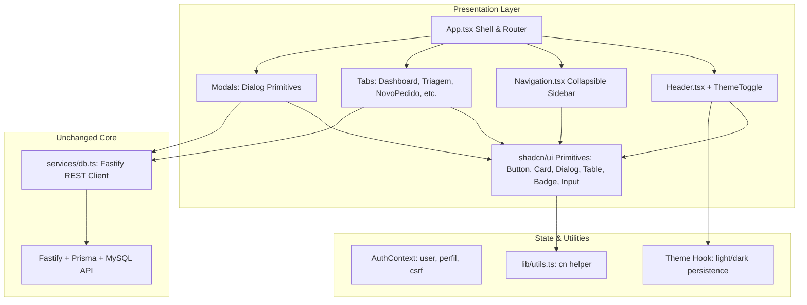

# UI Modernization & Rebrand Design

**Spec**: `.specs/features/ui-modernization-shadcn/spec.md`
**Status**: Approved

---

## Architecture Overview

The frontend architecture transitions from monolithic vanilla CSS and CDN icons to a modern modular system based on Tailwind CSS, shadcn/ui primitives, and Lucide React icons. The business logic layer (`dbService`, `AuthContext`, Fastify endpoints) remains completely untouched, serving as an immutable foundation for the presentation layer.



---

## Code Reuse Analysis

### Existing Components to Leverage

| Component | Location | How to Use |
| --- | --- | --- |
| `dbService` | `src/client/services/db.ts` | 100% reused without changes for all Fastify API calls |
| `useAuth` / `AuthContext` | `src/client/context/AuthContext.tsx` | Reused for authentication state, user profile, and CSRF token |
| `types` | `src/client/types/index.ts` | Reused for all TypeScript models, enums, and component prop types |
| Tab & Modal Logic | `src/client/components/tabs/*` and `modals/*` | State hooks, handlers, calculations, and submissions remain identical |

### Integration Points

| System | Integration Method |
| --- | --- |
| Fastify REST API | Unchanged HTTP fetch calls via `dbService` |
| LocalStorage | Stores `theme` ('light' | 'dark') and sidebar collapsed state |
| Tailwind CSS Engine | Configured via `tailwind.config.js` and `postcss.config.js` with Vite plugin |

---

## Components and Primitives

### 1. Design System Primitives (`src/client/components/ui/`)

- **`button.tsx`**: Button with CVA variants (`default` teal, `destructive` rose, `outline` slate border, `secondary` slate, `ghost`, `link`) and size variants (`sm`, `md`, `lg`, `icon`).
- **`card.tsx`**: Card, CardHeader, CardTitle, CardDescription, CardContent, CardFooter with subtle border and elevation.
- **`badge.tsx`**: Badge with semantic variants (`default`, `secondary`, `destructive`, `outline`, `success` emerald, `warning` amber, `info` cyan).
- **`dialog.tsx`**: Accessible modal dialog using Radix UI Dialog primitives with smooth backdrop blur, keyboard ESC dismissal, and focus trapping.
- **`input.tsx` & `textarea.tsx`**: Form inputs with focus-ring teal, muted placeholders, and dark mode borders.
- **`table.tsx`**: Table, TableHeader, TableBody, TableRow, TableHead, TableCell with hover highlights and border dividers.
- **`tooltip.tsx`**: Radix Tooltip for displaying titles when the sidebar is collapsed.
- **`tabs.tsx`**: Radix Tabs for sub-navigation (e.g., inside EquipamentosTab or Relatórios).

### 2. Layout & Shell Components

- **`Header.tsx`**: Modern header bar with OdontoGest logo in cyan gradient, active view breadcrumb, User Avatar & role badge, Theme Toggle (Sun/Moon), and primary action triggers.
- **`Navigation.tsx`**: Collapsible sidebar with Lucide icons (`LayoutDashboard`, `ClipboardList`, `FilePlus2`, `Wrench`, `Wallet`, `Stethoscope`, `Boxes`, `Users`, `ChevronLeft`, `ChevronRight`).
- **`Toast.tsx`**: Re-styled floating notification component with Lucide icons (`CheckCircle2`, `AlertCircle`, `Info`, `X`).

---

## Data Models (if applicable)

No modifications to database or API data models. The only frontend UI state addition is the Theme type:

```typescript
export type Theme = 'light' | 'dark';

export interface ThemeContextType {
  theme: Theme;
  setTheme: (theme: Theme) => void;
  toggleTheme: () => void;
}
```

---

## Error Handling Strategy

| Error Scenario | Handling | User Impact |
| --- | --- | --- |
| Fastify API fetch failure | Existing try/catch in dbService and tabs | Renders styled error Toast notification |
| Invalid form submission | Visual validation styling (border-destructive) | Clear visual indication on the invalid field |
| Theme preference corrupt in localStorage | Fallback to system preference or 'light' | App safely defaults to light theme without crashing |

---

## Risks & Concerns

| Concern | Location (file:line) | Impact | Mitigation |
| --- | --- | --- | --- |
| CSS specificity conflicts with legacy index.css | `src/client/index.css:1` | Old classes could override Tailwind utility styles | Reset index.css to use `@tailwind` directives and define design tokens as CSS variables |
| Missing FontAwesome icons after CDN removal | `index.html:12` | Unconverted icons might render as blank | Full audit of all `.tsx` files to replace `fa-*` with Lucide equivalents before CDN removal |
| Modals overflow on smaller screens | `src/client/components/modals/*` | Action buttons clipped on mobile/laptop viewports | Use `max-h-[85vh] overflow-y-auto` inside DialogContent |

---

## Tech Decisions (only non-obvious ones)

| Decision | Choice | Rationale |
| --- | --- | --- |
| Utility merger library | `clsx` + `tailwind-merge` (`cn` helper) | Standard in shadcn/ui to prevent conflicting Tailwind class names |
| Icon system | `lucide-react` | Scalable SVGs, treeshakeable, native dark/light stroke styling |
| Dialog & Tooltip headless engine | `@radix-ui/react-dialog` & `@radix-ui/react-tooltip` | Industry standard accessibility, keyboard navigation, and portal management |

---
